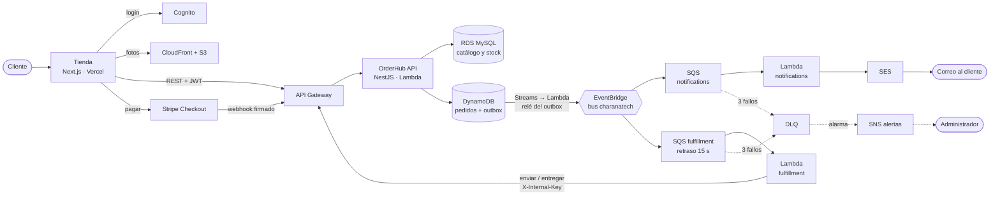
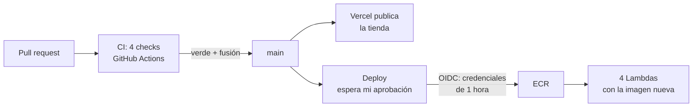

# CharanaTech · powered by OrderHub

[](https://github.com/isnayder-charana/charana-ecommerce/actions/workflows/ci.yml)

Tienda de accesorios tecnológicos hecha como pieza de portafolio: una tienda real, en producción, con pagos, eventos y despliegue continuo. Puedes comprar con una tarjeta de prueba y ver cómo avanza tu pedido.

**Tienda en vivo: [charana-ecommerce.vercel.app](https://charana-ecommerce.vercel.app)**

## Pruébalo tú (3 minutos)

1. Abre la tienda y pulsa **Iniciar sesión**. Entra con **Google** o crea una cuenta con tu correo.
2. Agrega uno o dos productos al carrito y pulsa **Continuar compra**.
3. Pulsa **Pagar con Stripe** y usa la tarjeta de prueba:

   | Campo   | Valor                                |
   | ------- | ------------------------------------ |
   | Tarjeta | `4242 4242 4242 4242`                |
   | Fecha   | cualquier fecha futura, como `12/34` |
   | CVC     | cualquier número de 3 cifras         |
   | Nombre  | el que quieras                       |

4. Vuelves a la página del pedido. Quédate ahí: se actualiza sola.
   - En unos segundos pasa a **Pagado** (Stripe avisó a la API con un webhook).
   - Unos 15 s después, **Enviado**; otros 15 s, **Entregado**. Lo mueve un worker que escucha los eventos del pedido.
5. Baja hasta **Correos de este pedido**: son los correos que la tienda te habría enviado en cada paso.

Stripe está en **modo de prueba**: no se cobra nada y la tienda nunca ve los datos de la tarjeta. Detalles en la [página de privacidad](https://charana-ecommerce.vercel.app/privacidad).

## Qué hay detrás

| Área                | Qué usé                                                                                                                                                                                            |
| ------------------- | -------------------------------------------------------------------------------------------------------------------------------------------------------------------------------------------------- |
| **Tienda**          | Next.js 16 (App Router, Server Actions), Tailwind, TanStack Query, React Hook Form + Zod, login con Cognito (correo o Google)                                                                      |
| **API (OrderHub)**  | NestJS con arquitectura hexagonal y DDD, Prisma + MySQL para el catálogo y el stock, DynamoDB para pedidos, Stripe Checkout con webhook firmado                                                    |
| **Eventos**         | Patrón outbox, EventBridge, SQS con DLQ, workers en Lambda idempotentes, correos con SES, alarmas con CloudWatch y SNS                                                                             |
| **Infraestructura** | Terraform con estado remoto en S3; API y workers en Lambda (imágenes Docker), API Gateway, RDS, CloudFront + S3 para las fotos, secretos en SSM                                                    |
| **Calidad y CI/CD** | Vitest y Jest con cobertura mínima del 80 %, tests de integración contra MySQL y DynamoDB reales, GitHub Actions en cada pull request, despliegue con OIDC (sin claves de AWS) y aprobación manual |

Cada decisión está explicada, paso a paso, en la [bitácora](#bitácora-de-aprendizaje).

## Estructura del monorepo

```
charanatech/
├─ apps/
│  ├─ web/       # Next.js 16 (tienda, Vercel)
│  ├─ api/       # NestJS hexagonal + DDD (OrderHub, Lambda)
│  └─ workers/   # Lambdas que consumen eventos (SQS)
├─ infra/        # Terraform (AWS)
├─ scripts/      # ecr-push.sh y smoke-prod.sh
└─ docs/pasos/   # Bitácora: qué se hizo en cada paso y por qué
```

## Cómo funciona una compra



1. El cliente paga en **Stripe**. Stripe avisa a la API con un **webhook firmado** y el pedido pasa a **Pagado**.
2. La API guarda el pedido y su evento `OrderPaid` en **una sola transacción** (outbox). **DynamoDB Streams** dispara el relé, que lo publica en **EventBridge**.
3. EventBridge reparte el evento a las colas **SQS**. El worker `notifications` envía el correo con **SES** y guarda una copia para la página del pedido. El worker `fulfillment` espera 15 s (retraso de la cola) y le pide a la API que envíe el pedido. Eso genera `OrderShipped`, y el ciclo se repite hasta **Entregado**.
4. Si un mensaje falla 3 veces, va a su **DLQ** y se avisa al administrador por **SNS**.

En tu PC, EventBridge, SQS, SES y SNS los emula **LocalStack** y DynamoDB es **DynamoDB Local** (`pnpm infra:up`).

### Del commit a producción



## Costos

Todo corre en una cuenta de AWS con créditos y un límite de gasto activo.

| Qué                                                                   | Al mes, aprox.                   |
| --------------------------------------------------------------------- | -------------------------------- |
| RDS MySQL `db.t4g.micro` encendida (instancia, disco e IPv4)          | USD 18                           |
| Lambda, API Gateway, DynamoDB, SQS, EventBridge, SES, CloudFront, ECR | Centavos (dentro de lo gratuito) |
| CloudWatch: 3 alarmas                                                 | USD 0.30                         |
| Vercel Hobby y GitHub Actions (repo público)                          | Gratis                           |
| **Total**                                                             | **≈ USD 19**                     |

Lo único caro es la base de datos siempre encendida. Lo demás cobra por uso, y una demo casi no lo usa.

## Correr en tu PC

- Node **26.13.0** (ver `.nvmrc`)
- pnpm **12.18.0** (Node 25+ ya no trae Corepack: se instala con npm)

- Docker (para MySQL, DynamoDB Local y LocalStack)

```bash
npm install -g pnpm@12.18.0
pnpm install
cp apps/api/.env.example apps/api/.env        # y lo mismo en apps/web y apps/workers
pnpm infra:up                                 # MySQL, DynamoDB Local y LocalStack
pnpm --filter @charanatech/api db:deploy
pnpm --filter @charanatech/api db:tables
pnpm --filter @charanatech/api db:seed
pnpm dev                                      # tienda en http://localhost:3001
pnpm check                                    # formato, lint, tipos y tests
```

Los `.env` necesitan las claves de prueba de Stripe y los datos de Cognito: cada guía de la bitácora explica de dónde sale cada valor.

## Bitácora de aprendizaje

1. [Paso 1: esqueleto del monorepo](docs/pasos/01-monorepo.md)
2. [Paso 2: API NestJS hexagonal + DDD](docs/pasos/02-api-hexagonal.md)
3. [Paso 3: módulo Catalog](docs/pasos/03-catalog.md)
4. [Paso 4: módulo Orders](docs/pasos/04-orders.md)
5. [Paso 5: autenticación con JWT de Cognito](docs/pasos/05-auth-cognito.md)
6. [Paso 6: calidad (linter, reglas de arquitectura, pnpm check)](docs/pasos/06-calidad.md)
7. [Paso 7 (parte 1): servicios locales con docker compose](docs/pasos/07-docker-compose.md)
8. [Paso 7 (parte 2): Catalog con Prisma y MySQL](docs/pasos/07b-prisma-mysql.md)
9. [Paso 7 (parte 3): Orders con DynamoDB](docs/pasos/07c-dynamodb.md)
10. [Paso 8: documentación interactiva con Swagger](docs/pasos/08-swagger.md)
11. [Paso 9 (fase 2): base de la tienda en Next.js](docs/pasos/09-web-base.md)
12. [Paso 10 (fase 2): productos reales desde la API](docs/pasos/10-productos-desde-la-api.md)
13. [Paso 11 (fase 2): página de detalle del producto](docs/pasos/11-detalle-producto.md)
14. [Paso 12 (fase 2): página de catálogo con búsqueda y categorías](docs/pasos/12-catalogo.md)
15. [Paso 13 (fase 2): carrito guardado en una cookie](docs/pasos/13-carrito-cookie.md)
16. [Paso 14 (fase 2): tests del frontend con Vitest](docs/pasos/14-tests-web.md)
17. [Paso 15 (fase 2): Terraform y el User Pool de Cognito](docs/pasos/15-terraform-cognito.md)
18. [Paso 16 (fase 2): "Continuar con Google"](docs/pasos/16-google.md)
19. [Paso 17 (fase 2): inicio de sesión en la tienda](docs/pasos/17-inicio-de-sesion.md)
20. [Paso 18 (fase 2): "Continuar compra" crea el pedido](docs/pasos/18-crear-pedido.md)
21. [Paso 19 (fase 3): pagar con Stripe Checkout](docs/pasos/19-stripe-checkout.md)
22. [Paso 20 (fase 3): el webhook de Stripe marca el pedido como Pagado](docs/pasos/20-webhook-stripe.md)
23. [Paso 21 (fase 3): AWS en tu PC con LocalStack](docs/pasos/21-localstack.md)
24. [Paso 22 (fase 3): la API publica sus eventos (outbox + EventBridge)](docs/pasos/22-outbox-eventos.md)
25. [Paso 23 (fase 3): los workers que consumen los eventos](docs/pasos/23-workers.md)
26. [Paso 24 (fase 3): correos al cliente con SES](docs/pasos/24-correos-ses.md)
27. [Paso 25 (fase 3): el pedido avanza solo (envío automático)](docs/pasos/25-envio-automatico.md)
28. [Paso 26 (fase 3): alertas de la DLQ y la arquitectura completa](docs/pasos/26-alertas-dlq.md)
29. [Paso 27 (fase 4): el código sube a GitHub](docs/pasos/27-repositorio-github.md)
30. [Paso 28 (fase 4): el estado de Terraform se muda a S3](docs/pasos/28-estado-remoto-terraform.md)
31. [Paso 29 (fase 4): los datos se mudan a AWS (RDS, DynamoDB y SSM)](docs/pasos/29-datos-en-aws.md)
32. [Paso 30 (fase 4): la API sale a internet en Lambda](docs/pasos/30-api-en-lambda.md)
33. [Paso 31 (fase 4): los eventos y los workers se mudan a AWS](docs/pasos/31-eventos-en-aws.md)
34. [Paso 32 (fase 4): correos de verdad y alarmas que te escriben](docs/pasos/32-correos-y-alertas.md)
35. [Paso 33 (fase 4): fotos de los productos en S3 + CloudFront](docs/pasos/33-fotos-cloudfront.md)
36. [Paso 34 (fase 4): la tienda sale a internet en Vercel](docs/pasos/34-tienda-en-vercel.md)
37. [Paso 35 (fase 4): cada pull request se revisa solo (CI)](docs/pasos/35-ci-en-pull-requests.md)
38. [Paso 36 (fase 4): despliegue continuo con OIDC, sin claves guardadas](docs/pasos/36-despliegue-continuo-oidc.md)
39. [Paso 37 (fase 4): prueba de punta a punta en producción](docs/pasos/37-prueba-en-produccion.md)

## Créditos de las fotos

Las fotos de los productos son de [Unsplash](https://unsplash.com) y se usan bajo su licencia gratuita. Gracias a sus autores:

| Producto                     | Archivo          | Foto de                                                |
| ---------------------------- | ---------------- | ------------------------------------------------------ |
| Audífonos inalámbricos Pulse | `ct-aud-001.jpg` | [Cosmin Ursea](https://unsplash.com/@cosminursea)      |
| Cargador GaN 65W             | `ct-chg-001.jpg` | [Andrey Matveev](https://unsplash.com/@zelebb)         |
| Cable USB-C trenzado 2 m     | `ct-cab-001.jpg` | [Mika Baumeister](https://unsplash.com/@kommumikation) |
| Teclado mecánico compacto    | `ct-per-001.jpg` | [Hannes Köttner](https://unsplash.com/@hk_filmografy)  |
| Mouse ergonómico vertical    | `ct-per-002.jpg` | [Cemrecan Yurtman](https://unsplash.com/@cmrcn_)       |
| SSD portátil 1 TB            | `ct-sto-001.jpg` | [Cemrecan Yurtman](https://unsplash.com/@cmrcn_)       |
