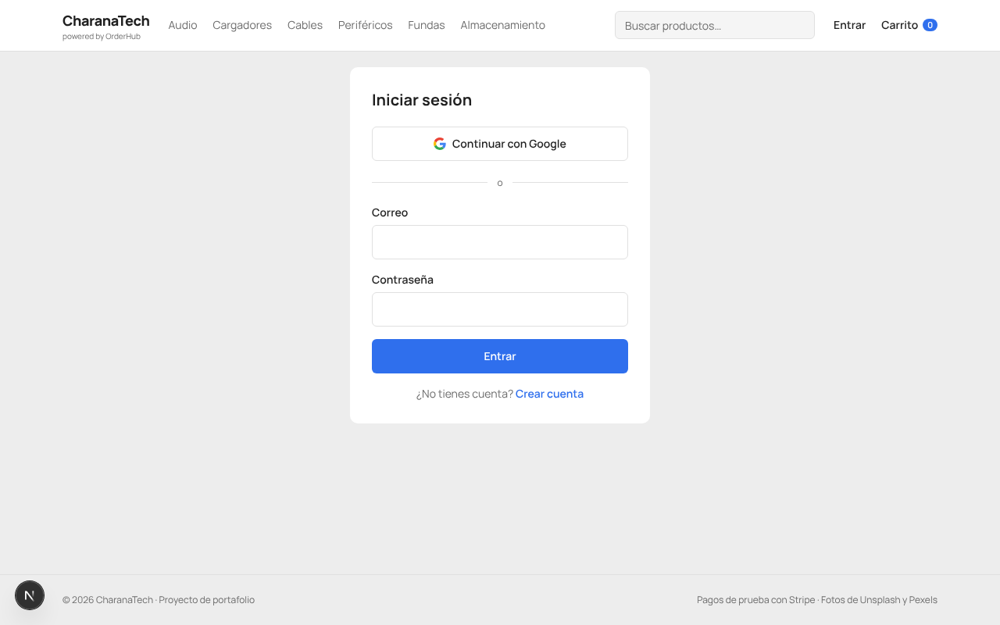
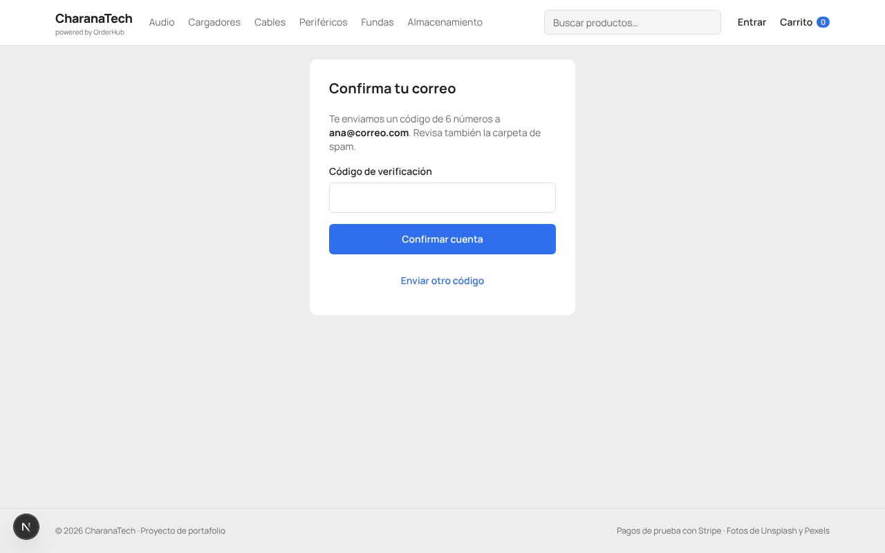
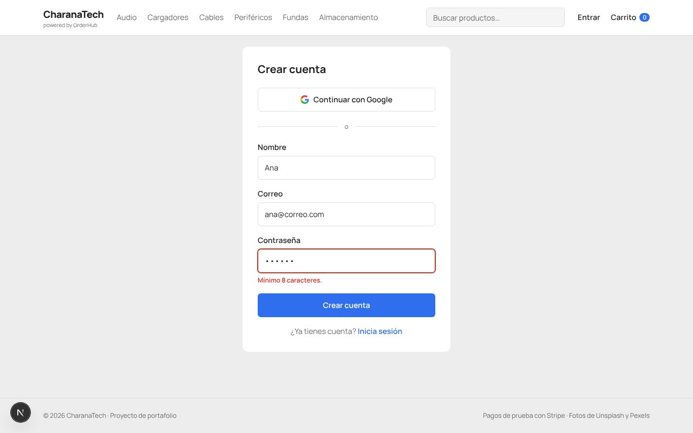
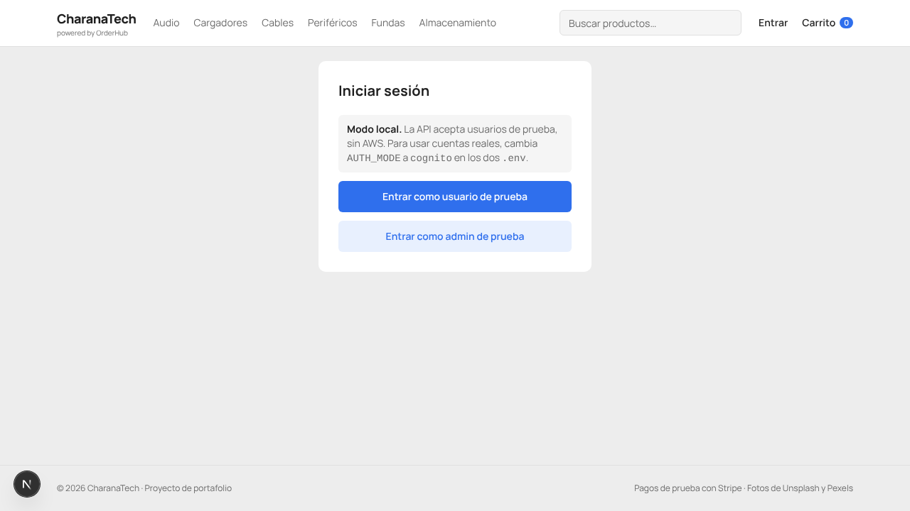

# Paso 17 (fase 2): inicio de sesión en la tienda

## Qué hicimos

La tienda ya tiene cuentas de usuario:

- **`/entrar`**: correo y contraseña, o **"Continuar con Google"**.
- **`/registro`**: nombre, correo y contraseña, y luego el **código de 6 números** que llega al correo.
- **`/auth/callback`**: la página a la que vuelve la persona después de Google.
- **Cabecera**: "Entrar" sin sesión; "Hola, Ana" y "Salir" con sesión.
- **Modo local**: con `AUTH_MODE=dev` no hace falta AWS; `/entrar` muestra dos botones de usuario de prueba.



```
apps/web/src/
├─ app/
│  ├─ entrar/page.tsx            # elige: formularios reales o botones de prueba
│  ├─ registro/page.tsx          # registro + confirmación con código
│  └─ auth/callback/page.tsx     # regreso de Google
├─ components/ui/
│  ├─ text-field.tsx             # campo con etiqueta y error accesibles
│  └─ form-alert.tsx             # mensaje arriba del formulario
└─ features/auth/
   ├─ session.ts                 # PUERTO AuthAdapter + tipo SessionUser
   ├─ cognito-auth.ts            # ADAPTADOR real (Amplify + Cognito)
   ├─ dev-auth.ts                # ADAPTADOR de prueba (solo local)
   ├─ auth-provider.tsx          # estado de la sesión para toda la tienda: useAuth()
   ├─ auth-config.ts             # lee NEXT_PUBLIC_AUTH_MODE y los ids de Cognito
   ├─ auth-schemas.ts            # validación con Zod (la misma política que el User Pool)
   ├─ auth-errors.ts             # errores de Cognito → mensajes en español
   ├─ return-to.ts               # ?volver=/carrito, sin "open redirect"
   ├─ sign-in-form.tsx · sign-up-form.tsx · google-button.tsx · dev-sign-in.tsx
   ├─ account-menu.tsx           # "Entrar" / "Hola, Ana · Salir"
   └─ oauth-callback.tsx         # espera el resultado de Google y vuelve a donde estabas
```

## Configurarlo en tu PC

Crea el archivo `apps/web/.env.local` (copia `apps/web/.env.example`) y completa:

```
NEXT_PUBLIC_AUTH_MODE=cognito
NEXT_PUBLIC_COGNITO_USER_POOL_ID=us-east-2_...
NEXT_PUBLIC_COGNITO_CLIENT_ID=...
NEXT_PUBLIC_COGNITO_DOMAIN=charanatech-....auth.us-east-2.amazoncognito.com
```

Los tres valores salen de `terraform -chdir=infra/terraform output` (`user_pool_id`, `client_id` y `login_domain`). No son secretos: también los ve el navegador.

**Importante:** `NEXT_PUBLIC_AUTH_MODE` de la tienda y `AUTH_MODE` de la API deben ser iguales. Si la tienda envía un token de Cognito a una API en modo `dev`, la API responde 401, y al revés también.

Después de cambiar un `.env.local`, **reinicia** `pnpm --filter @charanatech/web dev`: Next copia las variables `NEXT_PUBLIC_*` al código cuando arranca.

## La idea central: el mismo puerto que en la API

En el paso 5, la API tiene un **puerto** `TokenVerifier` con dos adaptadores (Cognito y dev). La tienda repite la misma idea:

```ts
interface AuthAdapter {
  currentUser(): Promise<SessionUser | null>;
  accessToken(): Promise<string | null>;   // para "Authorization: Bearer …"
  signOut(): Promise<void>;
  subscribe(onChange: () => void): () => void;
}
```

- `cognitoAuth` usa **Amplify**.
- `devAuth` guarda un usuario de prueba en el navegador y genera el token `dev:ana` (o `dev:admin:admin`), que la API acepta en modo `dev`.

El resto de la tienda solo usa `useAuth()` y no sabe cuál de los dos está detrás. Por eso los tests usan un tercer adaptador falso sin tocar el resto del código.

## Cómo se inicia sesión con correo y contraseña

Amplify usa **SRP** (*Secure Remote Password*): el navegador y Cognito hacen un intercambio matemático que prueba que conoces la contraseña **sin enviarla**, ni siquiera cifrada. Por eso el cliente de la tienda tiene `ALLOW_USER_SRP_AUTH` (paso 15).

Cognito devuelve tres tokens:

| Token | Para qué | Dónde lo usamos |
| --- | --- | --- |
| **ID token** | Quién es la persona: nombre, correo | El saludo "Hola, Ana" |
| **Access token** | Qué puede hacer: grupos, `client_id` | La cabecera `Authorization` de la API |
| **Refresh token** | Pedir tokens nuevos sin volver a escribir la contraseña | Amplify, solo, cuando vence el access token |

El access token dura **1 hora**; Amplify lo renueva solo con el refresh token durante **30 días**. Por eso `getAccessToken()` siempre devuelve uno vigente.

**¿Dónde guarda Amplify los tokens?** En el `localStorage` del navegador. Es lo habitual en una aplicación de navegador (SPA) y tiene un costo: si un script malicioso lograra ejecutarse en la página (XSS), podría leerlos. Lo mitigamos con un access token corto (1 hora), con React, que escapa todo el texto que muestra, y sin usar `dangerouslySetInnerHTML`. La alternativa es guardarlos en cookies `httpOnly` con un servidor intermedio (el patrón *BFF*), que es más seguro pero bastante más complejo.

## Cómo funciona "Continuar con Google"

```
1. Tienda   → guarda ?volver en sessionStorage
2. Amplify  → genera un secreto al azar (code_verifier) y su huella (code_challenge)
3. Navegador → Cognito /oauth2/authorize?identity_provider=Google&code_challenge=…
4. Cognito  → Google → la persona elige su cuenta → Cognito
5. Cognito  → /auth/callback?code=…
6. Amplify  → cambia el code por los tokens enviando el code_verifier (PKCE)
7. Tienda   → vuelve a la ruta guardada en el paso 1
```

**PKCE** (*Proof Key for Code Exchange*) es lo que hace seguro este flujo sin secreto. Si alguien roba el `code` de la URL, no le sirve: para cambiarlo por tokens también necesita el `code_verifier`, que nunca salió del navegador de la persona.

Lo comprobamos mirando la dirección a la que sale el botón: lleva `response_type=code`, `code_challenge=…` y `code_challenge_method=S256`.

## Registro con código

1. `signUp` crea el usuario en Cognito **sin confirmar** y Cognito envía el código al correo.
2. `confirmSignUp` comprueba el código.
3. Como pedimos `autoSignIn: true`, Amplify inicia la sesión sola, sin pedir otra vez la contraseña.

Si la persona se registra, cierra la página y vuelve otro día, al intentar entrar Cognito responde `UserNotConfirmedException`. La tienda la lleva a `/registro?confirmar=<correo>` para escribir el código, y luego a `/entrar` con el aviso "Cuenta confirmada".



## Formularios: React Hook Form + Zod

```ts
const { register, handleSubmit, formState } = useForm({ resolver: zodResolver(signUpSchema) });
```

- **Zod** valida con **la misma política** de contraseña que el User Pool (8 caracteres, mayúscula, minúscula, número). Así la persona ve el error al instante, sin esperar a Cognito. Cognito igual lo vuelve a validar: el navegador nunca es la última palabra.
- **React Hook Form** no vuelve a dibujar todo el formulario en cada tecla, y entrega los valores ya validados y transformados (por ejemplo, el correo en minúsculas y sin espacios).
- Cada campo conecta su error con `aria-describedby` y marca `aria-invalid`, así un lector de pantalla lee el error junto al campo.



## Mensajes de error que no revelan nada

Cognito responde en inglés y con nombres técnicos. `auth-errors.ts` los traduce, y lo que no conoce recibe un mensaje genérico, nunca el texto original.

Además, "ese correo no existe" y "contraseña incorrecta" muestran **el mismo mensaje**: "Correo o contraseña incorrectos". Si fueran distintos, cualquiera podría probar correos para saber quién tiene cuenta. Es la misma idea que `prevent_user_existence_errors` del paso 15.

## `?volver=` sin "open redirect"

Al hacer clic en "Entrar" desde el carrito, el enlace es `/entrar?volver=%2Fcarrito`, para regresar al carrito después. Pero si aceptáramos cualquier valor, alguien podría enviar este enlace:

```
https://charanatech.../entrar?volver=https://sitio-falso.com
```

La persona iniciaría sesión en la tienda real y terminaría en un sitio falso, que podría pedirle la contraseña "otra vez". `safeReturnTo()` solo acepta rutas internas (`/algo`) y rechaza `//sitio.com`, `https://…` y `/\sitio.com`.

## Modo local con usuario de prueba



Con `NEXT_PUBLIC_AUTH_MODE=dev` (el valor por defecto) no hace falta AWS para desarrollar. Los botones guardan `ana` o `admin` en el navegador, y la API, con `AUTH_MODE=dev`, acepta esos tokens. Este modo **nunca llega a producción**: la API se niega a arrancar con `AUTH_MODE=dev` si `NODE_ENV=production` (paso 5).

## Pruébalo

Con la API y la tienda en modo `cognito`:

1. **Correo:** entra con el usuario de prueba del paso 15 (`Prueba1234`). Arriba debe aparecer "Hola, …" y "Salir".
2. **Registro:** crea una cuenta con otro correo tuyo, escribe el código que llega y deberías quedar con la sesión iniciada.
3. **Google:** "Continuar con Google" con la cuenta que agregaste como usuario de prueba en Google Cloud (paso 16). Debes volver a la tienda con la sesión iniciada.
4. **Volver:** desde `/carrito`, haz clic en "Entrar"; después de iniciar sesión debes volver al carrito.
5. **Salir:** "Salir" cierra la sesión. Si entraste con Google, el navegador pasa un instante por Cognito para cerrar también esa sesión.

En la consola de AWS (**Cognito → User pools → charanatech-store → Users**) verás los usuarios nuevos.

## Tests

**94 tests** en la tienda (54 nuevos). Los de `features/auth` reemplazan Amplify por funciones falsas (`vi.mock('aws-amplify/auth')`) y comprueban:

| Archivo | Qué verifica |
| --- | --- |
| `return-to.test.ts` | Rutas internas sí; `https://…`, `//…`, `/\…` no |
| `auth-errors.test.ts` | Errores traducidos, correo normalizado, política de contraseña |
| `dev-auth.test.ts` | Tokens `dev:ana` y `dev:admin:admin`, valor manipulado ignorado |
| `cognito-auth.test.ts` | Configuración con código + PKCE, usuario armado desde los tokens |
| `auth-provider.test.tsx` | Cargando → con sesión, cambios desde otra pestaña, salir |
| `sign-in-form.test.tsx` | Validación, éxito, contraseña incorrecta, cuenta sin confirmar |
| `sign-up-form.test.tsx` | Registro → código → sesión; código incorrecto; reenviar código |
| `account-menu.test.tsx` | "Entrar" con `?volver`, saludo y "Salir" |
| `google-button.test.tsx` · `dev-sign-in.test.tsx` | Salida a Google y botones de prueba |

`oauth-callback.tsx` queda fuera de la cobertura: depende del viaje real a Google y se prueba en el navegador (punto 3 de arriba).

## Lo que aprendiste

- **Puertos y adaptadores también en el frontend:** Cognito o usuario de prueba, sin cambiar las páginas.
- **SRP:** iniciar sesión sin enviar la contraseña.
- **ID token vs access token vs refresh token**, y quién usa cada uno.
- **OAuth con PKCE:** un `code` robado no sirve sin el `code_verifier`.
- **Seguridad en detalles:** errores que no revelan quién tiene cuenta y `?volver` sin open redirect.
- **Formularios accesibles** con React Hook Form + Zod.

**Siguiente paso (18):** "Continuar compra" crea el pedido en la API con el token de la sesión, y las páginas "Mis pedidos" y el detalle del pedido.
