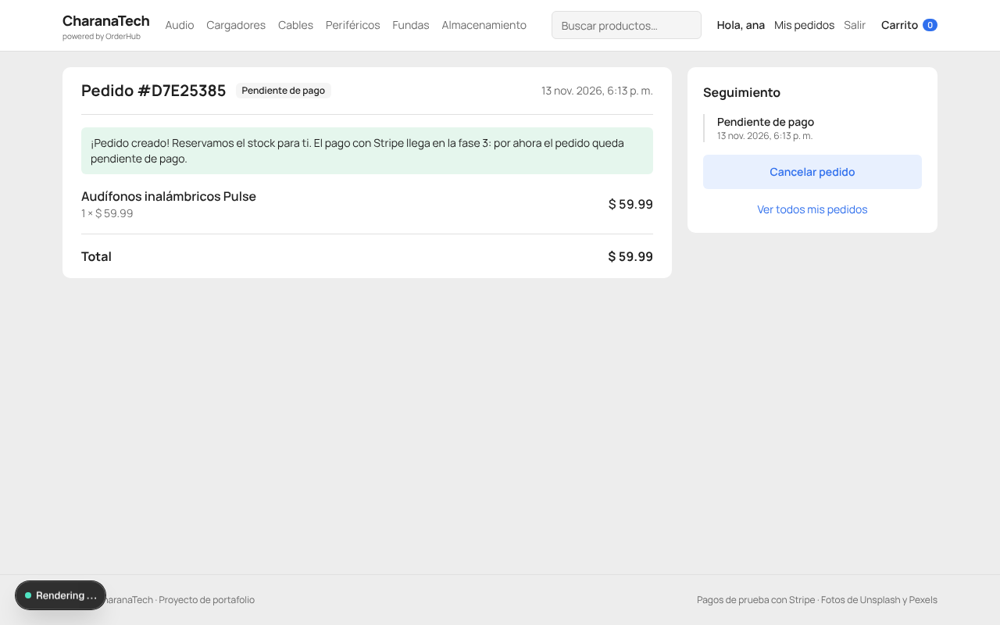
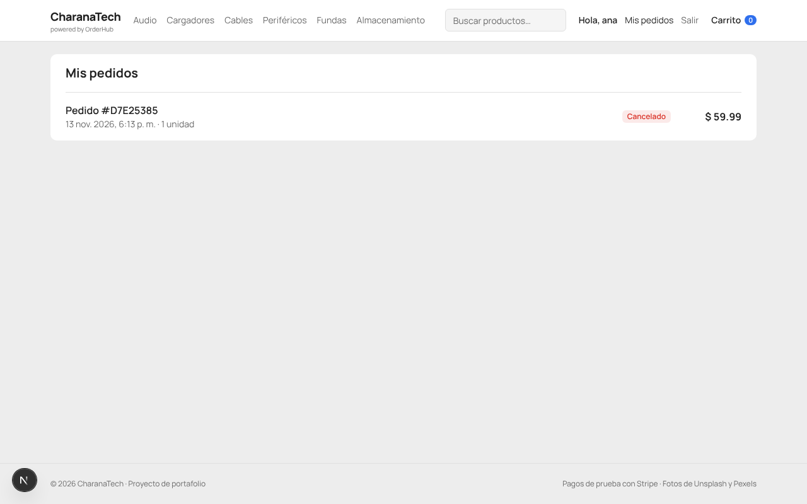
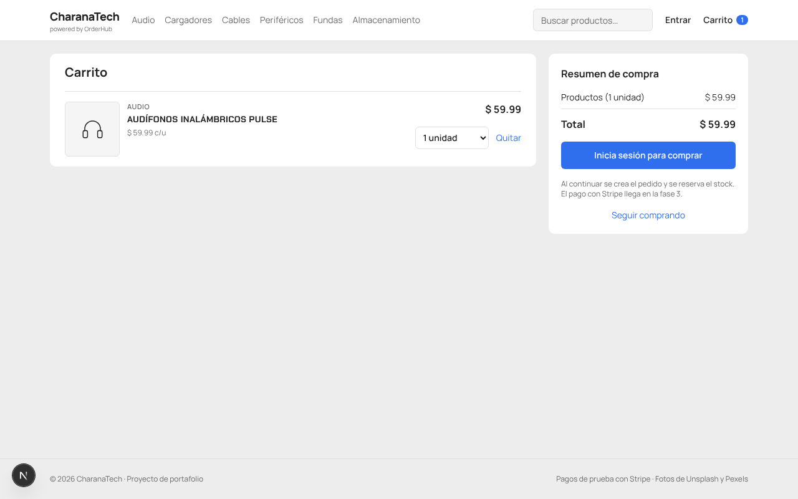

# Paso 18 (fase 2): "Continuar compra" crea el pedido

## Qué hicimos

Por primera vez la tienda y la API completan una compra juntas:

1. En el carrito, **"Continuar compra"** crea un pedido real en la API, que reserva el stock.
2. Si no hay sesión, el botón dice **"Inicia sesión para comprar"**, lleva a `/entrar` y después vuelve al carrito.
3. Al crearse, el carrito se vacía y se abre **`/pedidos/<id>`** con la confirmación.
4. **"Mis pedidos"** (`/pedidos`) lista tus pedidos, y desde el detalle puedes **cancelar** uno.



```
apps/web/src/
├─ lib/api-client.ts                 # + apiRequest(): POST, cuerpo JSON y token
├─ app/
│  ├─ carrito/page.tsx               # usa <CheckoutButton>
│  └─ pedidos/
│     ├─ page.tsx                    # Mis pedidos
│     └─ [id]/page.tsx               # Detalle (?nuevo=1 muestra la confirmación)
└─ features/orders/
   ├─ order.ts                       # esquema Zod de OrderView, estados en español, canCancel()
   ├─ checkout.actions.ts            # SERVER ACTION: carrito (cookie) → POST /api/orders
   ├─ checkout.ts                    # errores de la API → mensajes claros
   ├─ checkout-button.tsx            # el botón del carrito
   ├─ orders.queries.ts              # TanStack Query: mis pedidos, un pedido, cancelar
   ├─ require-session.tsx            # "Inicia sesión para ver tus pedidos"
   ├─ my-orders.tsx · order-detail.tsx · order-status-badge.tsx
   └─ order-page.tsx                 # une la sesión con cada página
```

## El viaje de un pedido

```
Navegador                      Servidor de Next             API (OrderHub)
─────────                      ────────────────             ──────────────
clic "Continuar compra"
getAccessToken() ─── token ──► placeOrderFromCart(token)
                               lee la cookie ct_cart
                               (solo productId + cantidad)
                               POST /api/orders ──────────► verifica el token (Cognito)
                               Authorization: Bearer …      toma precios del catálogo
                                                            reserva stock (todo o nada)
                                                            guarda el pedido (DynamoDB)
                               ◄────────── 201 + pedido ───
                               vacía la cookie
◄──── { ok, orderId } ─────────
abre /pedidos/<id>?nuevo=1
```

**¿Por qué una Server Action?** El carrito está en una cookie **httpOnly** (paso 13), y el JavaScript del navegador no la puede leer. Por eso el pedido se arma en el servidor de Next, que sí la lee. El navegador solo aporta el **token**.

**¿Quién decide el cliente y los precios?** La API, siempre:
- La Server Action reenvía el token, pero no decide quién compra: la API lo verifica y saca el `customerId` del propio token.
- No enviamos precios, solo `productId` y cantidad. La API toma el precio actual del catálogo. Aunque alguien manipulara la cookie o la petición, no podría pagar menos.

**El carrito se vacía solo si la API confirmó el pedido.** Si falla (por ejemplo, sin stock), el carrito queda como estaba y la página se recarga para marcar el producto con problema.

| La API responde | La tienda muestra |
| --- | --- |
| `201` | Abre el pedido con "¡Pedido creado!" |
| `401` (sesión vencida) | Lleva a iniciar sesión y vuelve al carrito |
| `409 INSUFFICIENT_STOCK` | "Uno de los productos ya no tiene stock suficiente" |
| `404 PRODUCT_NOT_FOUND` | "Uno de los productos ya no está a la venta" |
| Otro error o sin conexión | "No pudimos crear el pedido. Inténtalo otra vez" |

## Mis pedidos y el detalle



Estas páginas son **componentes de cliente**: el token vive en el navegador (Amplify), así que es el navegador quien pide los pedidos a la API, con TanStack Query:

```ts
queryKey: ['orders', userId]            // mis pedidos
queryKey: ['orders', userId, orderId]   // un pedido
```

El **id del usuario va en la clave de la caché**. Si en el mismo navegador sales y entra otra persona, nunca verá en pantalla los pedidos que quedaron guardados de la sesión anterior.

**Cancelar** usa una *mutation* de TanStack Query:
- Pide confirmación ("¿Seguro? … no se puede deshacer") antes de llamar a la API.
- La API responde con el pedido ya cancelado, y lo guardamos directo en la caché con `setQueryData`, sin volver a pedirlo.
- Marcamos "Mis pedidos" como desactualizado (`invalidateQueries`) para que muestre el nuevo estado.
- El botón solo aparece en **Pendiente de pago** y **Pagado**: la misma regla que la máquina de estados del dominio (paso 4).

**Pedidos de otra persona:** si alguien prueba el id de un pedido ajeno, la API responde **404**, no 403, y la tienda muestra "No encontramos este pedido". Así no se revela que ese pedido existe (paso 5).

**Colores del estado:** gris para los estados en curso, verde para **Entregado** y rojo para **Cancelado**. Es la regla del diseño: el color solo se usa cuando significa algo.

## Sin sesión



`/pedidos` y `/pedidos/<id>` muestran "Inicia sesión para ver tus pedidos", con un enlace que vuelve a la misma página. En el carrito, el botón cambia a "Inicia sesión para comprar".

La cabecera ahora tiene el enlace **"Mis pedidos"** junto al saludo.

## Pruébalo

Con la API y la tienda corriendo (sirve tanto en modo `dev` como en `cognito`):

1. Agrega un par de productos al carrito **sin haber iniciado sesión** y haz clic en "Inicia sesión para comprar".
2. Inicia sesión: vuelves al carrito. Haz clic en "Continuar compra".
3. Se abre el pedido con "¡Pedido creado!" y el carrito de la cabecera queda en 0.
4. Abre la ficha del producto: el **stock bajó** en la cantidad que compraste.
5. Cancela el pedido: el estado pasa a **Cancelado** y el stock **vuelve**.
6. En "Mis pedidos" aparece el pedido, con su estado.
7. **Sin stock:** pon en el carrito más unidades de las que quedan (desde otra pestaña, compra casi todo el stock de un producto) y luego intenta comprar: verás el aviso de stock y el carrito no se vacía.

Con `AUTH_MODE=cognito` y `PERSISTENCE=database`, el pedido queda guardado en DynamoDB Local con tu id de Cognito.

## Tests

**118 tests** en la tienda (24 nuevos):

| Archivo | Qué verifica |
| --- | --- |
| `api-client.test.ts` | `apiRequest` envía el cuerpo JSON y el token en `Authorization` |
| `order.test.ts` | Esquema del pedido, `canCancel` igual que la API, mensajes de cada error |
| `checkout-button.test.tsx` | Sin sesión → iniciar sesión; con sesión → crea y abre el pedido; sesión vencida; sin stock |
| `orders-pages.test.tsx` | Mis pedidos (con token, vacío, reintentar), detalle, cancelar con confirmación, pedido ajeno = no encontrado |

`checkout.actions.ts` queda fuera de la cobertura, como las otras Server Actions: solo corre dentro de Next. La probamos de punta a punta con la API real (pasos de arriba).

## Lo que aprendiste

- **El precio lo decide el backend:** la tienda solo envía qué y cuánto.
- **Server Action + cookie httpOnly + token:** cada pieza en el lugar donde se puede leer.
- **Datos privados en la caché:** la clave incluye al usuario.
- **Mutations:** confirmar, actualizar la caché con la respuesta e invalidar lo relacionado.
- **No revelar lo que no es tuyo:** 404 en vez de 403.

**Siguiente:** con esto termina la fase 2 en local. Lo que sigue en el plan es la fase 3 (pago con Stripe y eventos que cambian el estado solos) o publicar la tienda en Vercel (fase 4).
